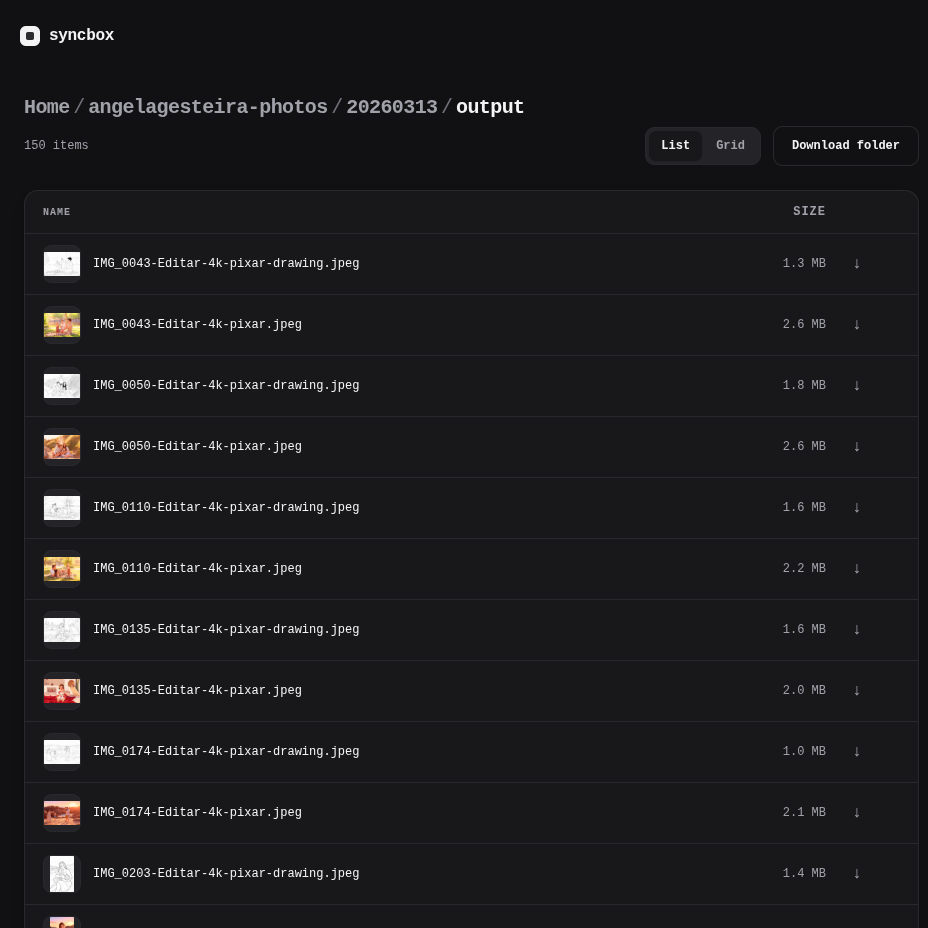

# Syncbox

Small Haskell web app for browsing a local directory over HTTP. It
indexes a root folder (in-memory), watches for changes, and serves a
minimal file browser UI.



## Features

- Browse folders/files with breadcrumbs and list/grid views.
- Inline previews via `/file/:id/raw` with HTTP byte-range support
  for media seeking.
- Thumbnails for supported images/video (first frame for animated media).
- Downloads as `.tgz` archives (files and folders), streamed.
- Live index updates (`fsnotify`).

## Run

```sh
nix run github:damianfral/syncbox -- --help

Usage: syncbox [--port INT] [--root STRING] [--hidden]

Available options:
  -h,--help                Show this help text
  --port INT               port (default: 3333)
  --root STRING            directory to server (default: ".")
  --hidden                 include hidden directories and files
```
